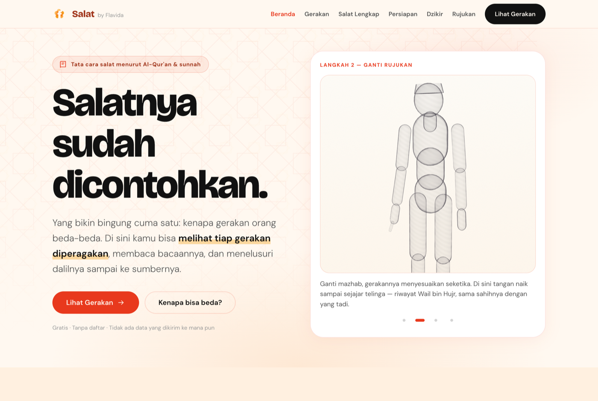
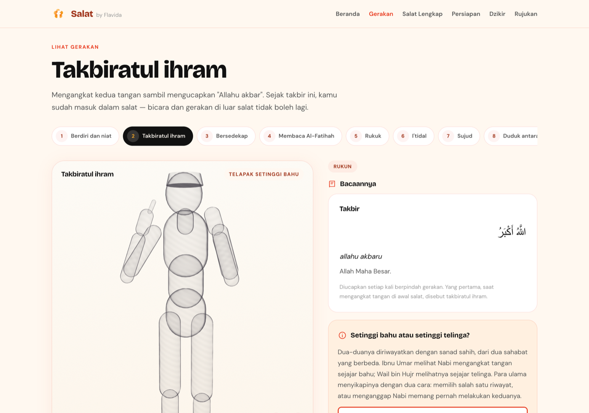
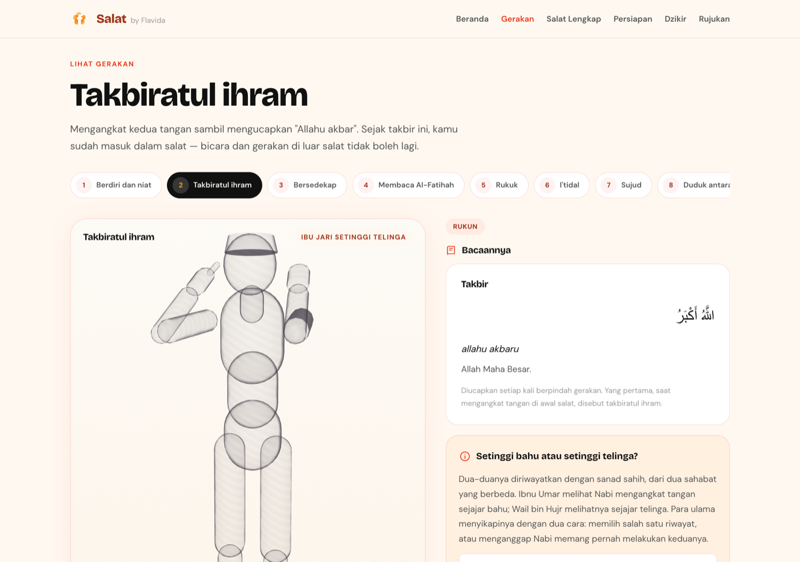
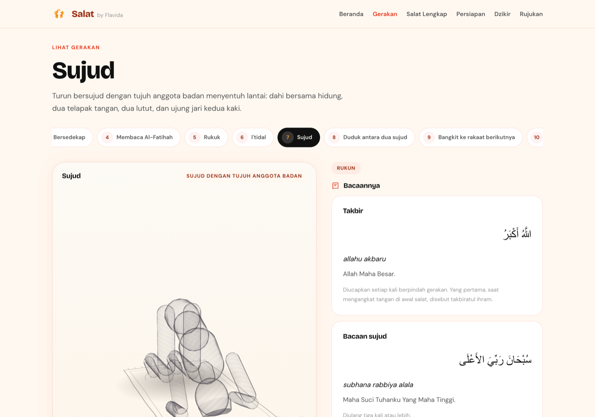
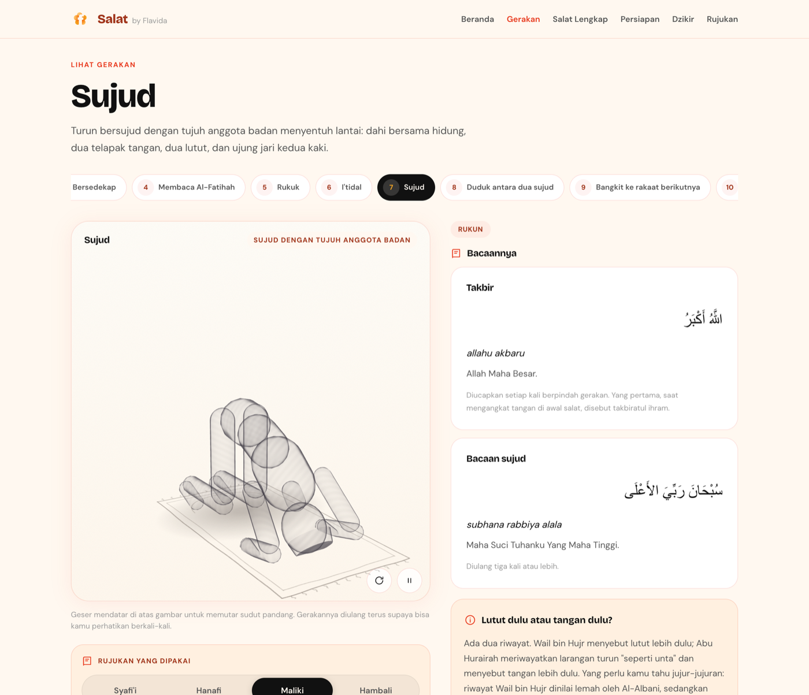
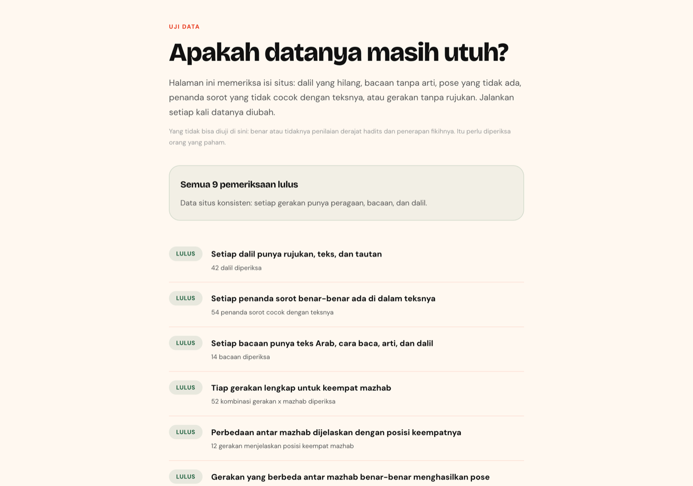

# Salat

Cara salat sesuai Al-Qur'an dan sunnah — dilihat, bukan dibayangkan.

Situs statis berbahasa Indonesia yang memperagakan tiap gerakan salat dalam animasi 3D,
lengkap dengan bacaan dan dalilnya. Rujukan mazhab bisa diganti kapan saja, dan gerakannya
menyesuaikan seketika.

**Gratis · tanpa daftar · tidak ada data yang dikirim ke mana pun.**



---

## Kenapa situs ini ada

Orang di sebelahmu mengangkat tangan sampai telinga, kamu sampai bahu. Dia qunut, kamu
tidak. Buat yang baru belajar — apalagi yang baru masuk Islam — pemandangan seperti ini
bikin ragu: jangan-jangan salatku selama ini salah.

Padahal hampir semua perbedaan itu berasal dari riwayat yang sama-sama sahih. Para sahabat
melihat Nabi salat pada waktu yang berbeda dan meriwayatkan apa yang mereka lihat. Para
ulama menimbang riwayat itu dan sampai pada kesimpulan yang sedikit berbeda.

Situs ini menunjukkan perbedaannya apa adanya, beserta dalil tiap pendapat — supaya orang
berhenti bingung, bukan supaya punya bahan baru untuk berdebat.

| Takbiratul ihram menurut Syafi'i | Takbiratul ihram menurut Hanafi |
|---|---|
|  |  |

Jaraknya cuma beberapa sentimeter. Dua-duanya dari sunnah.

---

## Isinya

| Halaman | Isi |
|---|---|
| `index.html` | Beranda: cara kerja situs, diperagakan langsung dengan mesin 3D yang sama |
| `gerakan.html` | 13 gerakan berurutan, animasi berulang, bacaan, dan dalil per gerakan |
| `lengkap.html` | Satu salat utuh per waktu (Subuh sampai Isya), berjalan otomatis |
| `persiapan.html` | Lima syarat sebelum salat, dengan dalilnya |
| `dzikir.html` | Dzikir sesudah salam |
| `rujukan.html` | Seluruh dalil yang dipakai + cara kurasinya |
| `tests.html` | Pemeriksaan data, dijalankan di peramban |



Empat mazhab tersedia sebagai rujukan: **Syafi'i** (baku), **Hanafi**, **Maliki**, dan
**Hambali**. Yang ditulis adalah pendapat masyhur tiap mazhab; kalau ada pendapat lain yang
penting, disebutkan di catatan.

---

## Cara kerjanya

Situs ini **statis**: HTML, CSS, dan JavaScript biasa, tanpa framework dan tanpa proses
build. Satu-satunya pustaka luar adalah [three.js](https://threejs.org) yang ikut disimpan
di repo ini (`js/vendor/`), jadi tidak ada permintaan ke CDN mana pun saat halaman dibuka.

```
salat/
├── data/           dalil, bacaan, gerakan, rakaat — seluruh isi situs
├── js/tiga/        mesin 3D: rig, pose, kamera, pemutar gerakan
├── js/ui-*.js      lapisan tampilan tiap halaman
├── css/            token desain Flavida, lapisan dasar, lapisan aplikasi
└── docs/           skrip kurasi dalil dan skrip tangkapan layar
```

### Modelnya sengaja berupa sketsa

Bukan manusia realistis: badan tembus pandang tanpa detail wajah, garis tepinya bergetar
seperti coretan pensil. Yang perlu terbaca adalah **sudut sendi dan posisi badan**, bukan
rupa orangnya.

Sudut tiap pose tidak dikira-kira. Untuk tiap sikap ditetapkan dulu sasaran dalam meter —
misalnya *"telapak setinggi bahu, 12 cm di depan badan"* untuk takbir menurut riwayat Ibnu
Umar, atau *"dahi, dua telapak, dua lutut, dan ujung dua kaki menyentuh lantai"* untuk
sujud — lalu sudut sendinya dicari sampai titik dunia sendi itu jatuh pada sasarannya.

### Dalilnya tidak diketik ulang

Teks Arab, terjemahan, dan derajat hadits **disalin apa adanya** dari sumbernya oleh skrip
kurasi (`docs/kurasi-dalil.py`), dijalankan sekali lalu disimpan sebagai berkas data. Saat
kamu membuka situsnya, tidak ada mesin pencari dan tidak ada AI yang dipanggil.

Bahkan lafaz bacaan salat pun tidak diketik ulang: takbir, tasyahud, dan yang lain **diiris
langsung dari teks hadits sumbernya** oleh skrip itu. Kalau penanda irisannya salah, skrip
berhenti dengan galat — bukan diam-diam menghasilkan kutipan yang keliru.

Sumber:
- Hadits — [hadits.id](https://www.hadits.id)
- Al-Qur'an — [equran.id](https://equran.id) (mushaf dan terjemahan Kementerian Agama)
- Konteks hukum Indonesia — [Pasal.id](https://pasal.id)

### Aturan yang dijaga

1. **Kutipan tidak pernah dipenggal.** Teks dalil selalu tampil utuh; bagian yang sedang
   dibahas hanya disorot.
2. **Derajat hadits ditulis apa adanya**, termasuk ketika sebuah riwayat dinilai lemah —
   lihat pembahasan "lutut dulu atau tangan dulu" pada gerakan sujud.
3. **Tidak ada aturan baru.** Situs ini menyusun dan mengutip, tidak berfatwa.



---

## Menjalankan di komputer sendiri

Tidak perlu memasang apa pun. Cukup jalankan server statis:

```bash
python3 -m http.server 8471
```

Lalu buka `http://localhost:8471`.

Untuk memeriksa datanya, buka `http://localhost:8471/tests.html` — halaman itu memeriksa
setiap dalil, bacaan, pose, dan rangkaian rakaat.



### Mengambil ulang tangkapan layar

```bash
bash docs/tangkap-layar.sh
```

### Mengambil ulang dalil dari sumbernya

```bash
python3 docs/ambil-hadits.py https://www.hadits.id/hadits/bukhari/735
python3 docs/kurasi-dalil.py
```

---

## Ikut memperbaiki

Ini menyangkut ibadah, jadi jangan percaya begitu saja — periksa. Yang paling dibutuhkan:

- **Koreksi dalil** — nomor hadits, derajat, atau terjemahan yang keliru.
- **Koreksi gerakan** — sudut badan di animasi yang tidak sesuai uraian riwayatnya.
  Untuk menunjuk sikap tertentu, tambahkan `&langkah=N` pada alamat halaman gerakan,
  misalnya `gerakan.html?g=sujud&m=maliki&langkah=2` — peragaan akan berhenti tepat di
  sikap itu sehingga mudah dibicarakan.
- **Pendapat mazhab yang terlewat**, lengkap dengan rujukan kitabnya.

Tidak bisa ngoding? Tulis saja di
[Issues](https://github.com/arnantoakbar/salat/issues/new) dengan bahasa biasa. Yang
diperlukan ilmunya, bukan kodenya.

---

## Batasan

- **Alat bantu belajar, bukan pengganti guru dan bukan lembaga fatwa.** Untuk keadaan
  khusus — sakit, cedera, atau kondisi lain yang tidak dibahas di sini — tanyakan kepada
  ustadz atau ulama yang kamu percaya.
- **Pencocokan dengan sumber daring memastikan nomor dan teksnya benar, tapi tidak
  menggantikan pemeriksaan orang yang kompeten** — terutama untuk penilaian derajat hadits,
  yang antar ulama pun bisa berbeda. Kode bisa diuji; keabsahan kutipan tidak.
- **Sudut pada model 3D adalah perkiraan** yang disetel terhadap uraian dalam riwayatnya.
  Tetap ada kemungkinan meleset sedikit — laporkan kalau kamu menemukannya.

---

## Lisensi

Kode: [MIT](LICENSE).

Teks Al-Qur'an, hadits, dan terjemahannya bukan milik proyek ini — hak dan ketentuannya
mengikuti sumbernya masing-masing (hadits.id, equran.id/Kementerian Agama). three.js
memakai lisensi MIT (`js/vendor/three.LICENSE.md`).

---

Dibuat dengan 🔥 di Indonesia · bagian dari [Flavida](https://flavida.co)
